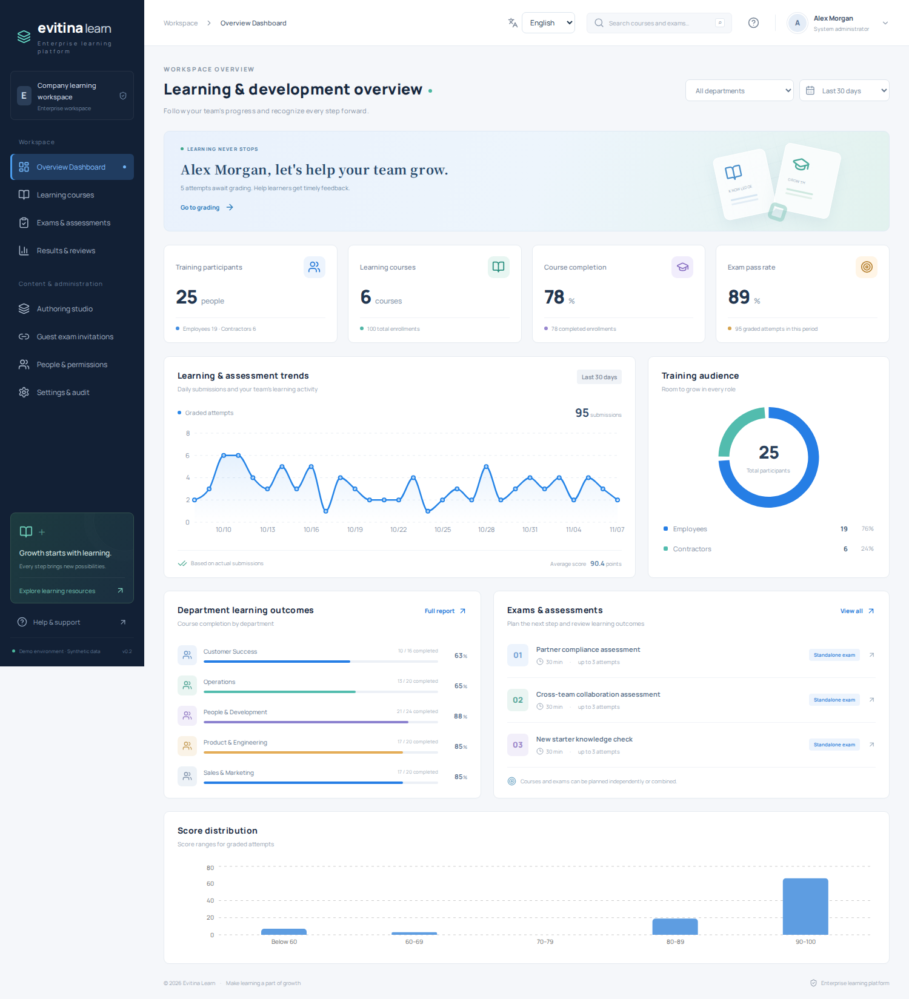
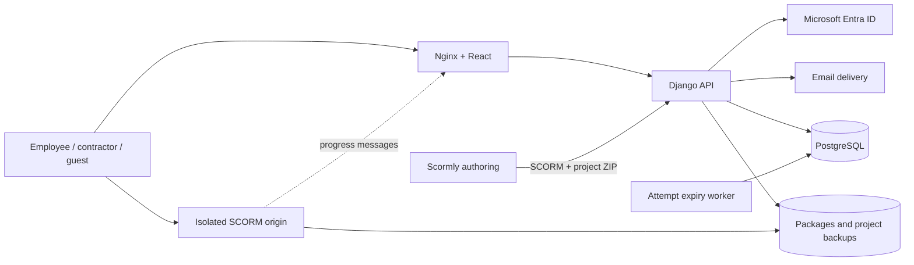
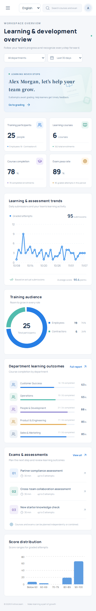

# Evitina Learn · Enterprise learning & assessment

[](https://github.com/teddashh/Training-System/actions/workflows/ci.yml)

[English](README.md) · [繁體中文](docs/README.zh-TW.md) · [Español](docs/README.es.md)

A self-hosted training, course authoring and assessment platform for employees, contractors and invited participants. Built from [FOSSEE/Yaksh](https://github.com/FOSSEE/online_test), with a modern application and integrated Scormly authoring.

**English is the default.** Switch to Traditional Chinese or Spanish from the sign-in page, workspace, course editor or exam. The platform and authoring studio share the preference, without discarding unsaved edits or exam answers. Authored course content, questions and names keep their original language.

**Upstream feature parity is incomplete.** The [source-linked audit](docs/UPSTREAM-AUDIT.md) reviews all four reference repositories, 146 feature groups, 155 Yaksh route declarations and 32 Scormly block types. It distinguishes tested workflows, partial implementations, missing features, retained source and upstream placeholders. The missing workflows remain required implementation work; a successful build does not mean full parity.

This v1.3 handover release runs with a real database and tested end-to-end workflows. [Peach1 handover](docs/PEACH1-HANDOVER.md) covers deployment, backup/restore, the Graph provisioning contract and company acceptance tests. Live Graph synchronization, Entra/SMTP configuration and infrastructure validation belong to the Peach1 integration stage. The public repository contains no company credentials or live deployment.



[Invitation cohorts](docs/screenshots/invitations.png) · [Learner feedback](docs/screenshots/learner-feedback.png) · [Assessment insights](docs/screenshots/insights.png) · [Required training report](docs/screenshots/assignments.png) · [Question bank](docs/screenshots/question-bank.png)

## Capabilities

| Area | Implemented behavior |
| --- | --- |
| Authentication | Microsoft Entra single-tenant OIDC/MSAL; email, username or employee ID with password; email sign-in codes for provisioned accounts |
| People | Roles, employment types and departments; CSV preview/atomic onboarding; profile editing, password changes and account deactivation |
| Learning | Course creation, publication, block lessons, self-enrollment and completion records |
| Required training | Assign courses or exams to people, departments or employment groups; due dates, learner worklists, completion/overdue reports and CSV |
| SCORM | ZIP validation/import, isolated content origin, SCORM 1.2/2004 single-SCO runtime subset, progress, suspend-data persistence and confirmed save on close |
| Authoring | Integrated Scormly with English, Traditional Chinese and Spanish; **Publish to LMS** uploads the selected SCORM 1.2 or 2004 format and an editable project backup to a course the author can manage |
| Exams | Standalone or course-linked; seven question types, including integer, numeric with per-answer tolerance and ordering; question banks, random subsets and shuffled options; scheduling, duration, passing score and shared retry intervals |
| Instructor preview | Full question-paper/answer-key inspection, timed learner simulation and untimed draft testing; private resumable trials and test grading without participant evidence |
| Audience | All accounts, employees, contractors, selected departments, selected people or invitation only; enforced by the API |
| Attempts | Default and individual budgets; invitation-specific caps; shared account/guest identity; PostgreSQL locking prevents concurrent overuse |
| Guest access | Unique expiring/revocable links bound to an email/account key; CSV batch preview/issuance with retry recovery and link download; searchable, paginated history; recipient email verification enabled by default in organizer forms |
| Grading | Attempt snapshots, ordered autosave with conflict detection and retry, server timing, idempotent submission, automatic scoring and learner-visible instructor feedback |
| Reporting | Filtered, paginated results and matching CSV; exam score distributions, department performance and question analysis from frozen attempt snapshots; completion, trends and audit records |

## Architecture

React 19, TypeScript, Vite and Recharts; Python 3.13, Django 5.2 LTS, Django REST Framework and MSAL; PostgreSQL 17; Nginx, Gunicorn and Docker Compose. Azure blue and Evitina-inspired teal, dark navigation and spacious cards form the visual system.



## Run with Docker

Requires Docker Engine and Compose v2. From the repository root:

```bash
cp .env.example .env
python3 -c "import secrets; print(secrets.token_urlsafe(48))"
# Set SECRET_KEY to the generated value; set a separate POSTGRES_PASSWORD.
docker compose up --build -d --wait
docker compose exec api python manage.py createsuperuser
```

The Django superuser flag and enterprise role are separate. Assign the first administrator's platform role:

```bash
docker compose exec api python manage.py shell -c \
  "from training.models import User; User.objects.filter(is_superuser=True).update(role='admin')"
```

- Workspace: <http://localhost:8080>
- Authoring: <http://localhost:8080/studio/#/app>
- Advanced administration: <http://localhost:8080/admin/>
- Content origin: `http://localhost:8081`, accessible through signed launches

Compose binds only to loopback. PostgreSQL and media persist in Docker volumes. See [deployment and identity setup](docs/DEPLOYMENT.md) for HTTPS, Entra, SMTP and operations.

### Synthetic demonstration data

Set `DEBUG=true` and `DEMO_MODE=true` in `.env`, recreate the services, then choose a demonstration password of at least 12 characters:

```bash
docker compose exec -e DEMO_PASSWORD='Your-local-demo-password' api python manage.py seed_demo
```

Administrator: `admin@evitina.example`. Learner: `learner1@evitina.example`, also accessible with employee ID `E0002`. Both use the password you supplied. The seed command creates English sample content and does not modify existing accounts or authored material.

## Development and verification

```bash
uv venv --python 3.13
uv pip install -r backend/requirements.txt
npm ci --prefix frontend
npm ci --prefix vendor/scormly
DEBUG=true .venv/bin/python backend/manage.py migrate
DEBUG=true DEMO_PASSWORD='Your-local-demo-password' .venv/bin/python backend/manage.py seed_demo
```

Run these in four terminals:

```bash
DEBUG=true DEMO_MODE=true .venv/bin/python backend/manage.py runserver 127.0.0.1:8000
DEBUG=true DJANGO_SETTINGS_MODULE=config.content_settings .venv/bin/python backend/manage.py runserver 127.0.0.1:8001
npm run dev --prefix frontend
npm run dev --prefix vendor/scormly -- --base=/studio/ --port 5174 --host 127.0.0.1
```

Open <http://localhost:5173>. Local commands do not automatically load `.env`; Compose passes its explicitly configured variables.

```bash
DEBUG=true .venv/bin/python backend/manage.py test training
# Includes the real PostgreSQL concurrency check:
docker compose exec api python manage.py test training
npm run build --prefix frontend
npm run build --prefix vendor/scormly -- --base=/studio/
npm test --prefix vendor/scormly
python3 scripts/check_upstream_audit.py
npx --prefix frontend playwright install chromium
DEMO_PASSWORD='Your-local-demo-password' npm run test:e2e --prefix frontend
```

For the guest email browser test, start the development API with `EMAIL_BACKEND=django.core.mail.backends.filebased.EmailBackend EMAIL_FILE_PATH=/tmp/training-test-mail` and run Playwright with `TEST_EMAIL_DIR=/tmp/training-test-mail`. Use this local mail sink only for testing; normal deployment uses SMTP. CI runs this test against real generated messages without exposing verification codes.

GitHub Actions checks PostgreSQL authorization/budget/grading tests, both frontend builds, Scormly unit tests, browser workflows, active dependency audits, deployment image builds and upstream inventory integrity. The inventory check does not certify feature completeness. Language coverage includes dictionary placeholders, API validation, unsaved forms, active answers, studio preferences and mobile overflow.

## Integration and scope

Yaksh Git history and its original source remain in `legacy/yaksh/`. The supported enterprise API is a modern rebuild; the archived Django application and code sandbox are not deployed. The `import_yaksh` adapter accepts reviewed JSON for Yaksh `mcq`, `mcc`, `string`, `integer`, `float` and `arrange` questions; arrange imports require an explicit correct order. Full historical migration and isolated programming assessments remain unfinished; see the [feature audit and completion workstreams](docs/UPSTREAM-AUDIT.md), [integration details](docs/INTEGRATIONS.md), [third-party notices](THIRD_PARTY_NOTICES.md) and [security scope](SECURITY.md).

- SCORM supports a single-SCO runtime subset, without full certification, multi-SCO sequencing or a cmi5/xAPI LRS. Scormly can export cmi5, but this LMS does not accept it.
- A link issued with email verification disabled is a bearer credential. Verified links require the configured recipient mailbox before guest access. Neither mode provides exam proctoring.
- Multiple choice is all-or-nothing; short answers support per-answer case and spacing rules, with normalization as the default; written responses require instructor review. Question order, choice options and question subsets can be randomized. Organizers can require sequential answers and control completed-response visibility. File-upload assessment responses are not implemented.
- This is a single-company workspace. Courses support self-enrollment and required training assignments. Audience rules, explicit assignments and invitations govern new exam access; existing attempts remain accessible.
- Production rollout still requires company Entra/SMTP acceptance, data migration, backup restoration and load testing with the expected participant count.



## Company operations

See [training operations](docs/OPERATIONS.md) for assignments, reusable questions, onboarding and passwords; [Peach1 handover](docs/PEACH1-HANDOVER.md) for deployment and the later Entra/Graph connection. Run `python3 scripts/backup.py --help` for consistent PostgreSQL/media backups and restoration into a fresh isolated project.
