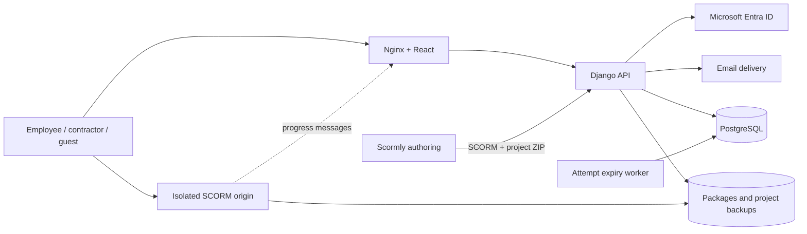

# Evitina Learn · Enterprise learning & assessment

[](https://github.com/teddashh/Training-System/actions/workflows/ci.yml)

[English](README.md) · [繁體中文](docs/README.zh-TW.md) · [Español](docs/README.es.md)

A self-hosted training, course authoring and assessment platform for employees, contractors and invited participants. Built from [FOSSEE/Yaksh](https://github.com/FOSSEE/online_test), with a modern application and integrated Scormly authoring.

**English is the default.** Switch to Traditional Chinese or Spanish from the sign-in page, workspace, course editor or exam. The platform and authoring studio share the preference, without discarding unsaved edits or exam answers. Authored course content, questions and names keep their original language.

This v0.2 implementation runs with a real database and tested end-to-end workflows. Company Entra ID and SMTP configuration are required before organizational use; the public repository does not include a live company deployment.


## Capabilities

| Area | Implemented behavior |
| --- | --- |
| Authentication | Microsoft Entra single-tenant OIDC/MSAL; email, username or employee ID with password; email sign-in codes for provisioned accounts |
| People | Administrator, instructor and learner roles; employees/contractors; departments; account deactivation; unique login identifiers |
| Learning | Course creation, editing, publication, block lessons, self-enrollment and completion records |
| SCORM | ZIP validation/import, isolated content origin, SCORM 1.2/2004 single-SCO runtime subset, progress and suspend-data persistence |
| Authoring | Integrated Scormly with English, Traditional Chinese and Spanish; **Publish to LMS** uploads SCORM 1.2 and an editable project backup |
| Exams | Standalone or course-linked; single/multiple choice, short answers and written responses; opening/closing times, duration and pass score |
| Audience | All accounts, employees, contractors, selected departments, selected people or invitation only; enforced by the API |
| Attempts | Default and individual budgets; invitation-specific caps; shared account/guest identity; PostgreSQL locking prevents concurrent overuse |
| Guest access | Unique expiring/revocable links bound to an email/account key; optional recipient email verification, enabled by default in the organizer form |
| Grading | Attempt snapshots, autosave, server timing, idempotent submission, automatic scoring, instructor review and feedback |
| Reporting | Real API-backed participation, completion, pass rates, department performance, trends, score distribution, CSV exports and audit records |

## Architecture

React 19, TypeScript, Vite and Recharts; Python 3.13, Django 5.2 LTS, Django REST Framework and MSAL; PostgreSQL 17; Nginx, Gunicorn and Docker Compose. Azure blue and Evitina-inspired teal, dark navigation and spacious cards form the visual system.



## Run with Docker

Requires Docker Engine and Compose v2. From the repository root:

```bash
cp .env.example .env
python3 -c "import secrets; print(secrets.token_urlsafe(48))"
# Set SECRET_KEY to the generated value; set a separate POSTGRES_PASSWORD.
docker compose up --build -d --wait
docker compose exec api python manage.py createsuperuser
```

The Django superuser flag and enterprise role are separate. Assign the first administrator's platform role:

```bash
docker compose exec api python manage.py shell -c \
  "from training.models import User; User.objects.filter(is_superuser=True).update(role='admin')"
```

- Workspace: <http://localhost:8080>
- Authoring: <http://localhost:8080/studio/#/app>
- Advanced administration: <http://localhost:8080/admin/>
- Content origin: `http://localhost:8081`, accessible through signed launches

Compose binds only to loopback. PostgreSQL and media persist in Docker volumes. See [deployment and identity setup](docs/DEPLOYMENT.md) for HTTPS, Entra, SMTP and operations.

### Synthetic demonstration data

Set `DEBUG=true` and `DEMO_MODE=true` in `.env`, recreate the services, then choose a demonstration password of at least 12 characters:

```bash
docker compose exec -e DEMO_PASSWORD='Your-local-demo-password' api python manage.py seed_demo
```

Administrator: `admin@evitina.example`. Learner: `learner1@evitina.example`, also accessible with employee ID `E0002`. Both use the password you supplied. The seed command creates English sample content and does not modify existing accounts or authored material.

## Development and verification

```bash
uv venv --python 3.13
uv pip install -r backend/requirements.txt
npm ci --prefix frontend
npm ci --prefix vendor/scormly
DEBUG=true .venv/bin/python backend/manage.py migrate
DEBUG=true DEMO_PASSWORD='Your-local-demo-password' .venv/bin/python backend/manage.py seed_demo
```

Run these in four terminals:

```bash
DEBUG=true DEMO_MODE=true .venv/bin/python backend/manage.py runserver 127.0.0.1:8000
DEBUG=true DJANGO_SETTINGS_MODULE=config.content_settings .venv/bin/python backend/manage.py runserver 127.0.0.1:8001
npm run dev --prefix frontend
npm run dev --prefix vendor/scormly -- --base=/studio/ --port 5174 --host 127.0.0.1
```

Open <http://localhost:5173>. Local commands do not automatically load `.env`; Compose passes its explicitly configured variables.

```bash
DEBUG=true .venv/bin/python backend/manage.py test training
# Includes the real PostgreSQL concurrency check:
docker compose exec api python manage.py test training
npm run build --prefix frontend
npm run build --prefix vendor/scormly -- --base=/studio/
npm test --prefix vendor/scormly
npx --prefix frontend playwright install chromium
DEMO_PASSWORD='Your-local-demo-password' npm run test:e2e --prefix frontend
```

For the guest email browser test, start the development API with `EMAIL_BACKEND=django.core.mail.backends.filebased.EmailBackend EMAIL_FILE_PATH=/tmp/training-test-mail` and run Playwright with `TEST_EMAIL_DIR=/tmp/training-test-mail`. Use this local mail sink only for testing; normal deployment uses SMTP. CI runs this test against real generated messages without exposing verification codes.

GitHub Actions checks PostgreSQL authorization/budget/grading tests, both frontend builds, Scormly unit tests, browser workflows, active dependency audits and deployment image builds. Language coverage includes dictionary placeholders, API validation, unsaved forms, active answers, studio preferences and mobile overflow.

## Integration and scope

Yaksh Git history and its original source remain in `legacy/yaksh/`. The supported enterprise API is a modern rebuild; the archived Django application and code sandbox are not deployed. The `import_yaksh` adapter accepts equivalent JSON for Yaksh `mcq`/`mcc` exports. Full historical data migration and arbitrary code execution are outside this version. See [integration details](docs/INTEGRATIONS.md), [third-party notices](THIRD_PARTY_NOTICES.md) and [security scope](SECURITY.md).

- SCORM supports a single-SCO runtime subset, without full certification, multi-SCO sequencing or a cmi5/xAPI LRS. Scormly can export cmi5, but this LMS does not accept it.
- A link issued with email verification disabled is a bearer credential. Verified links require the configured recipient mailbox before guest access. Neither mode provides exam proctoring.
- Multiple choice is all-or-nothing; short answers ignore surrounding whitespace and case; written responses require instructor review. Question randomization and assignment uploads are not implemented.
- This is a single-company workspace. Courses support self-enrollment; exam audience rules govern new account attempts, while existing attempts remain accessible and invitations grant separate access.
- Production rollout still requires company Entra/SMTP acceptance, data migration, backup restoration and load testing with the expected participant count.


