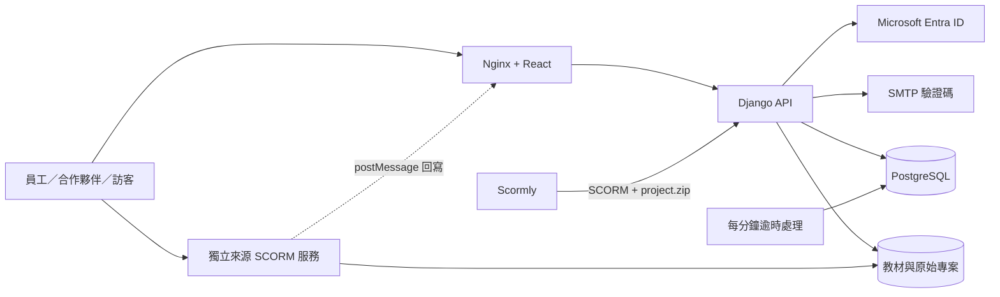

# Evitina Learn · 企業訓練與考核平台

[](https://github.com/teddashh/Training-System/actions/workflows/ci.yml)

以 [FOSSEE/Yaksh](https://github.com/FOSSEE/online_test) 為來源平台，重新建構的企業學習、教材製作、考試與評量系統。支援正式員工、非正式員工及無帳號受測者。

**這是可自行部署、具有實際資料庫與完整主要流程的 v0.1 首版。** Entra ID 與 SMTP 需要公司的設定才能使用；不是已接上公司身分目錄的正式上線服務。


## 已實作功能

| 領域 | 功能 |
| --- | --- |
| 身分驗證 | Microsoft Entra 單租用戶 OIDC／MSAL；E-mail、帳號、員工編號＋密碼；一次性 E-mail 驗證碼 |
| 人員管理 | 管理員、講師、學員；正式／非正式員工；部門；停用帳號；登入識別碼唯一性 |
| 課程 | 建立／編輯／發布、區塊教材、自主修課、完成紀錄 |
| SCORM | ZIP 驗證與匯入、獨立來源播放器、SCORM 1.2／2004 單一 SCO 執行期子集、進度與 suspend data 回寫及續讀 |
| 教材製作 | 整合完整 Scormly；新增 **Publish to LMS**，直接發布 SCORM 1.2＋備份可編輯原始專案；可下載原始專案重新開啟 |
| 考試 | 獨立考試或關聯課程；單選、複選、簡答、申論；開放時間、截止時間、時限、及格標準 |
| 次數控管 | 考試預設額度、每位受測者個別額度、每個訪客連結額度；帳號與訪客共用身分計數；資料庫鎖避免併發超額 |
| 訪客邀請 | 256-bit 隨機專屬連結、資料庫只存雜湊、到期／撤銷；固定綁定 E-mail／帳號身分，不因輸入新 E-mail 重置次數 |
| 作答評分 | 開考即扣次、重整續考、試卷快照、自動儲存、伺服器計時、重複交卷保護、人工評分與回饋 |
| Dashboard | 人員、修課完成率、通過率、部門成效、期間內趨勢、分數分布、CSV 匯出、稽核紀錄 |

Dashboard 統計由 API 查詢實際資料。畫面示範資料由 `seed_demo` 明確產生，不是前端硬編碼數字。

## 技術架構

- React 19、TypeScript、Vite、Recharts、Lucide
- Python 3.13、Django 5.2 LTS、Django REST Framework、MSAL
- PostgreSQL 17（正式執行）；SQLite（快速開發）
- Nginx、Gunicorn、Docker Compose、GitHub Actions、Playwright
- M365／Azure 藍與 Evitina 青綠、深色導覽、繁體中文主平台；Scormly 保留英文／烏克蘭文原版介面



## Docker 快速啟動

需要 Docker Engine 和 Compose v2。由專案根目錄執行：

```bash
cp .env.example .env
python3 -c "import secrets; print(secrets.token_urlsafe(48))"
# 將產生的值填入 .env 的 SECRET_KEY；另設定 POSTGRES_PASSWORD（建議英數字）。
docker compose up --build -d --wait
docker compose exec api python manage.py createsuperuser
```

`createsuperuser` 後，把企業角色設成 admin，或先使用下方的示範種子。Django 的 superuser 與平台的 role 是分開的權限欄位，命令如下：

```bash
docker compose exec api python manage.py shell -c \
  "from training.models import User; User.objects.filter(is_superuser=True).update(role='admin')"
```

- 主平台：<http://localhost:8080>
- Scormly：<http://localhost:8080/studio/#/app>
- Django 進階管理：<http://localhost:8080/admin/>
- SCORM 內容來源：`http://localhost:8081`，由播放器簽署啟動，不能直接任意存取檔案

Compose 只把服務綁在 `127.0.0.1`；不會將示範環境暴露到外網。資料保存在 `postgres` 與 `media` volumes。

### 載入合成示範資料

只允許 `DEBUG=true`。自己指定一組至少 12 碼的示範密碼：

```bash
docker compose exec -e DEMO_PASSWORD='Your-local-demo-password' api python manage.py seed_demo
```

管理員為 `admin@evitina.example`；學員為 `learner1@evitina.example`，也可用員工編號 `E0002` 登入。密碼是上一步自行指定的值。種子不會重複建立或重設已存在帳號。

### Entra 與 SMTP

詳見 [公司部署與 Entra 設定](docs/DEPLOYMENT.md)。必填環境變數：

- `ENTRA_TENANT_ID`、`ENTRA_CLIENT_ID`、`ENTRA_CLIENT_SECRET`
- Web redirect URI：`https://你的主平台網域/api/auth/entra/callback/`
- `EMAIL_HOST`、`EMAIL_PORT`、`EMAIL_HOST_USER`、`EMAIL_HOST_PASSWORD`、`DEFAULT_FROM_EMAIL`

Secret 只放在伺服器環境或 Key Vault，不放在前端或 GitHub。E-mail 驗證碼只開放管理員已建立的啟用帳號，不提供公眾自由註冊。

## 開發與測試

```bash
uv venv --python 3.13
uv pip install -r backend/requirements.txt
npm ci --prefix frontend
npm ci --prefix vendor/scormly
DEBUG=true .venv/bin/python backend/manage.py migrate
DEBUG=true DEMO_PASSWORD='Your-local-demo-password' .venv/bin/python backend/manage.py seed_demo
```

分別在四個終端啟動：

```bash
DEBUG=true DEMO_MODE=true .venv/bin/python backend/manage.py runserver 127.0.0.1:8000
DEBUG=true DJANGO_SETTINGS_MODULE=config.content_settings .venv/bin/python backend/manage.py runserver 127.0.0.1:8001
npm run dev --prefix frontend
npm run dev --prefix vendor/scormly -- --base=/studio/ --port 5174 --host 127.0.0.1
```

開發網址為 <http://localhost:5173>。本機開發不會自動載入 `.env`；Compose 會讀取 `.env` 並傳入明確列出的變數。

```bash
# API 與權限／次數／評分／SCORM 測試
DEBUG=true .venv/bin/python backend/manage.py test training
# 含 PostgreSQL 真實 row-lock 併發測試
docker compose exec api python manage.py test training
# 型別檢查與正式建置
npm run build --prefix frontend
npm run build --prefix vendor/scormly -- --base=/studio/
npm test --prefix vendor/scormly
# 已啟動開發服務且已有示範資料後
cd frontend
npx playwright install chromium
DEMO_PASSWORD='Your-local-demo-password' npm run test:e2e
```

GitHub Actions 會執行 PostgreSQL API 測試、兩個前端建置、Scormly 測試、瀏覽器端到端流程、依賴漏洞掃描，以及 Docker image 建置。瀏覽器測試包含教材發布、SCORM 續讀、訪客次數限制，以及教材匯入／預覽／貼上的 HTML 安全清理。

## 上游來源與移轉邊界

此 repository 保留 Yaksh Git 歷史，原始應用移至 `legacy/yaksh/`。**新的企業 API 是現代化重建，不是宣稱整套舊 Yaksh 已升級到 Django 5.2。** 舊程式與舊依賴不會在預設 Docker 環境啟動。程式題沙箱、舊成績資料與完整課程遷移尚未整合。

舊版依賴含已知漏洞，GitHub 仍會對封存 manifests 顯示告警；不要安裝或部署 `legacy/`。新平台的 Python／JavaScript lockfiles 有獨立的 CI 依賴掃描，詳見 [安全範圍](SECURITY.md)。

`import_yaksh` 支援 Yaksh `Question.dump_questions` 的 JSON 等價資料（`mcq`／`mcc`）。舊匯出的 `questions_dump.yaml` 可在受控轉換環境用 safe YAML loader 轉成 JSON 陣列；不支援的題型或小數配分會整批拒絕，避免悄悄改變評分語意。範例見 [移轉文件](docs/INTEGRATIONS.md)。

Scormly 已包含其原始碼及 MIT 授權；SCORM-LearningManagementSystem 的 API 表面被移植為新 runtime，保留原始參考與 MIT notice。School Dashboard 與 Evitina 網站僅參考視覺，未複製無明確授權的版型或品牌素材。詳見 [第三方來源](THIRD_PARTY_NOTICES.md)。

## v0.1 已知範圍

- 尚未使用公司的 Entra tenant 與 SMTP 端到端驗證；需設定後完成公司驗收。
- SCORM 為單一 SCO runtime 子集，**不是完整認證實作**。不支援多 SCO sequencing、cmi5／xAPI LRS 或完整互動元素驗證。Scormly 可匯出 cmi5，但本 LMS 不接受 cmi5。
- 訪客連結是 bearer credential：取得連結即取得指定身分的作答權。若需要證明本人 E-mail 所有權，需再加訪客 OTP；目前的 E-mail OTP 是帳號登入功能。
- 複選採全對才給分，簡答忽略前後空白與大小寫；申論人工評分。未加入題目隨機抽選、監考、上傳作業或執行任意程式碼。
- 目前是單公司工作空間；課程可自主修課，已發布考試對所有啟用帳號開放。尚未加入跨公司租戶隔離、指定群組考試或主管簽核工作流。
- 正式上線需完成公司資料移轉、備份還原演練、目標人數負載測試與公司資安驗收。


