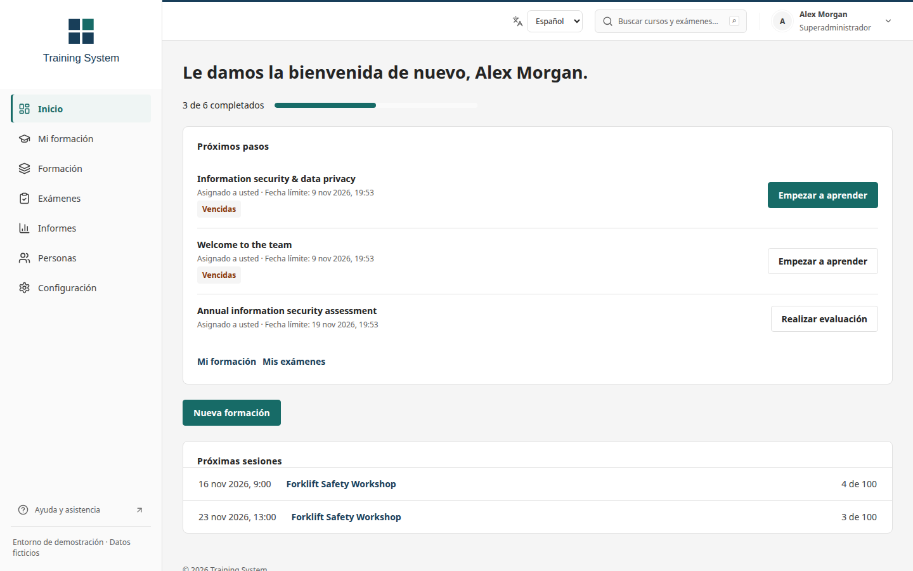

# Evitina Learn · Formación y evaluación empresarial

[English](../README.md) · [繁體中文](README.zh-TW.md) · Español

Plataforma autohospedada de formación, creación de cursos, exámenes y evaluación para empleados, contratistas y participantes invitados. Reconstruye la plataforma Yaksh con una API moderna e integra Scormly.

**El idioma predeterminado es el inglés.** Puede cambiar a chino tradicional o español desde el inicio de sesión, el espacio de trabajo, el editor o un examen. La plataforma y el estudio comparten la preferencia sin borrar cambios ni respuestas. Los contenidos de cursos, preguntas y nombres conservan su idioma original.

**La integración de todas las funciones de los repositorios originales aún está incompleta.** La [auditoría con referencias al código](UPSTREAM-AUDIT.md) revisa los cuatro repositorios, 146 grupos de funciones, 155 rutas de Yaksh y 32 tipos de bloques de Scormly. Distingue funciones verificadas, parciales, ausentes y código conservado. Las funciones pendientes siguen formando parte del trabajo requerido. La publicación permite elegir SCORM 1.2 o 2004 y solo muestra cursos que el autor puede gestionar.

Incluye SSO con Entra ID; acceso por correo, usuario o ID de empleado; cursos SCORM con reanudación; publicación y copia editable del proyecto; exámenes independientes; límites por participante; revisión manual y paneles de resultados. Los exámenes admiten audiencias de empleados, contratistas, departamentos, personas seleccionadas o solo invitados. Los enlaces pueden exigir verificación del correo del destinatario; el formulario del organizador activa esta opción de forma predeterminada.

Los responsables también disponen de un monitor de intentos con progreso guardado, contacto reciente, filtros y ampliaciones de tiempo auditadas. Reintentar una solicitud tras perder la respuesta no añade minutos dos veces. El temporizador se sincroniza con el servidor sin borrar cambios locales. Los responsables pueden inspeccionar respuestas guardadas en modo de solo lectura y reabrir explícitamente la última entrega. Se conservan las respuestas, notas y comentarios anteriores, sin consumir otro intento; la nota y la finalización actuales se retiran hasta la nueva entrega y revisión. Las reaperturas permiten reintentos seguros y rechazan escrituras de pestañas antiguas. El contacto reciente no demuestra atención. Consulte las [operaciones de supervisión](OPERATIONS.md#live-exam-monitoring-and-extra-time).

Desde la raíz del repositorio:

```bash
cp .env.example .env
# Configure un SECRET_KEY aleatorio y POSTGRES_PASSWORD.
docker compose up --build -d --wait
docker compose exec api python manage.py createsuperuser
docker compose exec api python manage.py shell -c \
  "from training.models import User; User.objects.filter(is_superuser=True).update(role='admin')"
```

Abra <http://localhost:8080>. Entra ID y SMTP requieren la configuración de su empresa; el repositorio público contiene el código, no un servicio corporativo ya desplegado. SCORM implementa un subconjunto para un solo SCO, sin certificación completa. El código antiguo de Yaksh es un archivo de referencia para migración y no debe desplegarse.

Consulte la [guía completa en inglés](../README.md), la [documentación de despliegue](DEPLOYMENT.md) y las [integraciones](INTEGRATIONS.md) para conocer los comandos, pruebas y límites.



## Entrega para despliegue corporativo

La rama principal permite configurar la espera entre inicios de intentos. Se comparte entre el acceso con cuenta y todos los enlaces del participante; conceder más intentos no elimina la espera. Los formularios muestran la próxima hora disponible según el reloj del servidor. La migración `0008` mantiene el valor 0 en los exámenes existentes. Consulta las [reglas de reintento](OPERATIONS.md#waiting-periods-between-exam-attempts).

La rama principal añade preguntas de respuesta entera, numérica con tolerancia individual y de ordenación. Funcionan en el banco de preguntas, el editor, los intentos de cuentas e invitados, el guardado, la revisión y los informes. La migración `0007` añade las tolerancias sin reescribir respuestas ni resultados históricos. Consulta las [reglas de preguntas](OPERATIONS.md#integer-numeric-and-ordering-questions) y la [actualización posterior a v1.3](PEACH1-HANDOVER.md#changes-after-v13). El idioma predeterminado sigue siendo inglés.

La versión 1.3 añade lotes de hasta 200 invitaciones desde CSV, validación de destinatarios y alias, creación atómica y recuperación de la misma solicitud durante diez minutos si se pierde la respuesta. Descarga los enlaces antes de cerrar; el historial permite buscar, filtrar y paginar. Desactivar una cuenta también bloquea sus enlaces y sesiones de invitado existentes, sin borrar respuestas ni intentos utilizados. Consulta la [actualización desde v1.2](PEACH1-HANDOVER.md#upgrade-from-v12) y las [operaciones de invitaciones](OPERATIONS.md#guest-invitation-cohorts). La integración corporativa de Entra y Graph sigue reservada para Peach1.

La versión 1.2 incorpora guardado ordenado, reintentos tras fallos de conexión y recuperación de conflictos entre ventanas. Los participantes pueden revisar sus respuestas y los comentarios del instructor. Los cursos SCORM esperan la confirmación del guardado antes de cerrar; el selector de preguntas mejora la navegación por teclado. La actualización incluye una migración de versiones de respuestas: consulta la [guía de actualización](PEACH1-HANDOVER.md#upgrade-from-v11). La integración activa de Entra y Graph sigue pendiente para Peach1.

La versión 1.1 añade resultados paginados con filtros y exportaciones coincidentes, análisis por evaluación y pregunta, y límites individuales visibles antes de comenzar un intento. Los informes analizan las preguntas guardadas en cada intento y respetan los permisos del administrador o instructor. [Vista del análisis](screenshots/insights.png).

La versión 1.0 añade formación obligatoria con plazos, informes de finalización, banco de preguntas, exámenes aleatorios, importación CSV y gestión de contraseñas. El idioma inicial sigue siendo inglés, con chino tradicional y español disponibles. Consulta la [entrega a Peach1](PEACH1-HANDOVER.md) y las [operaciones](OPERATIONS.md). La conexión corporativa de Entra, la sincronización de Graph y el correo se validarán en Peach1.

Las respuestas cortas ahora permiten varias alternativas de texto, cada una con su propia regla de mayúsculas y espacios. Se conservan las reglas históricas y las de cada intento; el editor, los invitados, la revisión y los informes usan las mismas reglas. La migración `0009` añade esta configuración. Consulta las [reglas de texto](OPERATIONS.md#text-answer-matching).

Los organizadores pueden exigir respuestas en orden y controlar la revisión posterior. El servidor oculta las preguntas futuras hasta guardar las respuestas anteriores; el tiempo límite sigue vigente. Se puede publicar la revisión después sin cambiar las notas. La migración `0010` conserva el comportamiento de los intentos existentes. Consulta las [políticas de navegación y revisión](OPERATIONS.md#navigation-and-completed-response-review).

Los instructores pueden inspeccionar el cuestionario completo, simular un examen abierto con temporizador o probar borradores sin límite de tiempo. Las pruebas privadas permiten guardar, reanudar y evaluar respuestas sin consumir intentos ni modificar resultados o formación completada. Se eliminan después de siete días. [Operación de vistas previas](OPERATIONS.md#instructor-exam-previews).

La importación CSV de calificaciones admite entregas de usuarios e invitados. Los responsables descargan una plantilla, revisan las notas y comentarios y aplican el lote completo; los siete tipos de pregunta admiten notas importadas. Se rechazan hojas y formularios desactualizados, se recuperan respuestas perdidas sin aplicar dos veces y se conservan las respuestas y los límites de intentos. El inglés sigue siendo el idioma predeterminado, con chino tradicional y español disponibles. Consulte el [formato y las operaciones de importación](OPERATIONS.md#marks-csv-imports).
