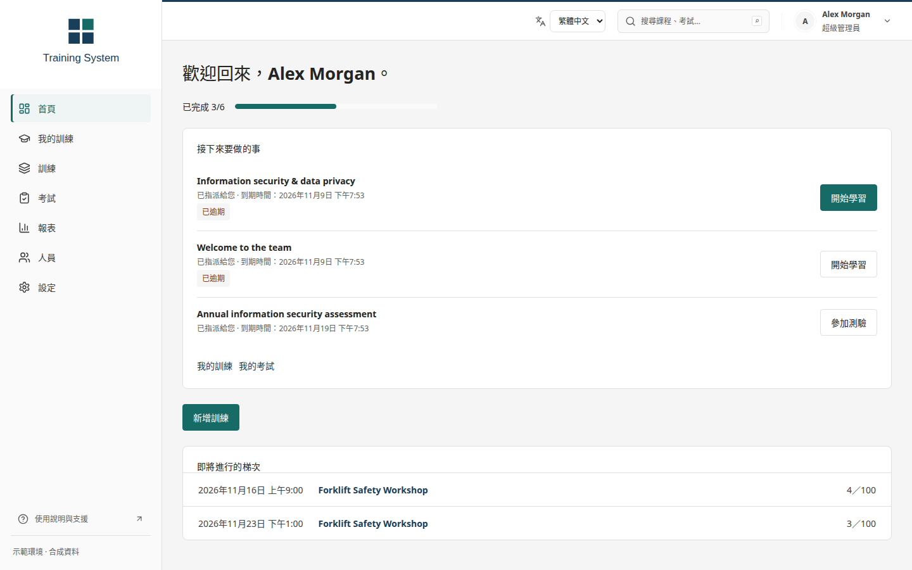

# Evitina Learn · 企業訓練與考核平台

[English](../README.md) · 繁體中文 · [Español](README.es.md)

管理者可透過即時考試監控檢視已儲存進度、近期連線、篩選作答紀錄，並留下可稽核的延長時間紀錄。回應遺失後重試同一請求不會重複增加時間，作答計時器也會同步伺服器並保留本機編輯。管理者可唯讀檢視已儲存答案，並明確重新開放最新的提交。原答案、成績與回饋保留為唯讀歷程，沿用相同作答次數；目前成績與完成狀態會撤回，直到再次提交及評分。重新開放請求可安全重試，舊分頁需重新載入。近期連線不代表專注程度。請參閱[監控操作說明](OPERATIONS.md#live-exam-monitoring-and-extra-time)。

支援正式員工、非正式員工及受邀訪客的自架學習、教材製作、考試與評分平台。以 Yaksh 為來源重建現代化 API，並整合 Scormly。

**預設介面為英文**，可在登入頁、平台、編輯器及考試頁切換繁體中文或西班牙文。平台與教材工作室共用語言偏好；切換不會清除未儲存的編輯或作答。使用者自行撰寫的教材、題目與姓名不會自動翻譯。

**原始儲存庫的完整功能整合仍未完成。** [附原始碼證據的稽核報告](UPSTREAM-AUDIT.md) 檢查四個儲存庫、146 組功能、155 個 Yaksh 路由宣告及 32 種 Scormly 區塊，區分已驗證、部分實作、缺漏及僅保留原始碼的項目。缺漏功能仍屬必要的後續實作工作。教材發布可選 SCORM 1.2 或 2004，且僅列出作者有權管理的課程。

主要功能包括 Entra ID SSO、Email／帳號／員工編號登入、SCORM 課程及續讀、教材發布與原始專案備份、獨立考試、個人次數限制、人工評分及 Dashboard。考試可限定正式員工、非正式員工、部門、指定人員或僅限邀請。訪客連結可要求收件者 Email 驗證，建立連結的介面預設啟用此功能。

從專案根目錄執行：

```bash
cp .env.example .env
# 設定隨機 SECRET_KEY 與 POSTGRES_PASSWORD。
docker compose up --build -d --wait
docker compose exec api python manage.py createsuperuser
docker compose exec api python manage.py shell -c \
  "from training.models import User; User.objects.filter(is_superuser=True).update(role='admin')"
```

開啟 <http://localhost:8080>。公司 Entra 與 SMTP 需另行設定；公開 GitHub 提供原始碼，不代表已部署公司正式服務。SCORM 為單一 SCO 執行期子集，尚非完整認證實作；舊 Yaksh 程式僅供封存與移轉參考，不應部署。

完整建置、測試與範圍請參閱 [英文說明](../README.md)、[部署文件](DEPLOYMENT.md) 與[整合文件](INTEGRATIONS.md)。



## 公司部署交接

目前主分支支援設定兩次開始作答的最短間隔，帳號與同一身分的所有訪客連結共用等待時間，增加可考次數不會略過等待。開始作答前會依伺服器時間顯示下一次可考時間。`0008` 遷移讓既有考試維持 0 分鐘、無需等待的原有行為。請參閱[重考間隔說明](OPERATIONS.md#waiting-periods-between-exam-attempts)。

目前主分支加入整數題、各答案可設定容許誤差的數值題，以及排序題，完整支援題庫、試卷編輯、帳號與訪客作答、自動儲存、檢視答案和成績分析。`0007` 遷移新增容許誤差欄位，不改寫歷史作答與成績。請參閱[題型操作說明](OPERATIONS.md#integer-numeric-and-ordering-questions)及 [v1.3 後續升級說明](PEACH1-HANDOVER.md#changes-after-v13)。預設介面仍為英文。

v1.3 加入最多 200 人的 CSV 批次邀請、收件者與登入別名驗證、整批建立，以及回應遺失後十分鐘內的相同請求復原。關閉前可下載個人連結；邀請紀錄支援搜尋、狀態篩選與分頁。停用帳號也會封鎖其既有訪客連結與工作階段，保留已儲存答案和應試次數。請參閱 [v1.2 升級說明](PEACH1-HANDOVER.md#upgrade-from-v12) 與[邀請操作說明](OPERATIONS.md#guest-invitation-cohorts)。公司 Entra／Graph 串接仍留待 Peach1。

v1.2 強化自動儲存順序、斷線重試與多視窗衝突處理，並讓學員查看自己的作答及講師回饋。SCORM 課程關閉前會等待儲存確認，題庫選擇視窗支援鍵盤操作。升級會套用答案版本欄位的資料庫遷移；請參閱 [Peach1 升級說明](PEACH1-HANDOVER.md#upgrade-from-v11)。Entra／Graph 串接仍留待 Peach1。

v1.1 加入伺服器分頁與篩選成績、符合相同篩選條件的 CSV 匯出、評量與題目分析，以及作答前的個人剩餘次數提示。報表採用每次作答保留的題目版本，並依管理員與講師權限限制資料範圍。[評量分析畫面](screenshots/insights.png)。

v1.0 加入必修訓練指派、截止日期、完成報表、可重複使用的題庫、隨機考題與選項、CSV 人員匯入及密碼管理。介面預設英文，亦提供繁體中文與西班牙文。請參閱 [Peach1 交接指南](PEACH1-HANDOVER.md) 與 [操作說明](OPERATIONS.md)。公司 Entra、Graph 同步及郵件連線於 Peach1 階段完成驗收。

簡答題現在可設定多個可接受的文字答案，並為每個答案選擇大小寫與空白比對規則。既有題目與歷史應試保留原有評分行為；編輯器、訪客應試、閱卷與報表共用相同比對規則。資料庫遷移 `0009` 新增此設定。詳見[文字答案操作說明](OPERATIONS.md#text-answer-matching)。

主辦者現在可要求依序作答，並控制交卷後的作答檢視。伺服器會在前面的答案儲存後才釋出後續題目；考試時間限制仍然有效。講師可在之後開放檢視作答，無須更改分數。遷移 `0010` 保留既有應試的操作行為。詳見[題目導覽與作答檢視政策](OPERATIONS.md#navigation-and-completed-response-review)。

講師可檢視完整試卷與答案、模擬已開放考試的計時應試，或不限時測試草稿。私人預覽支援儲存、續答及測試評分，不會消耗應試次數，也不影響正式成績或訓練完成紀錄；預覽會在七天後刪除。[預覽操作說明](OPERATIONS.md#instructor-exam-previews)。
