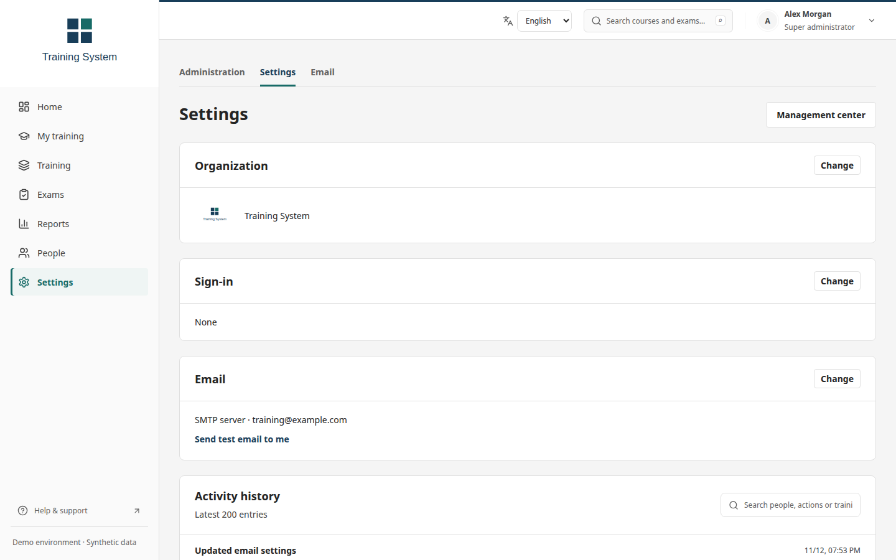
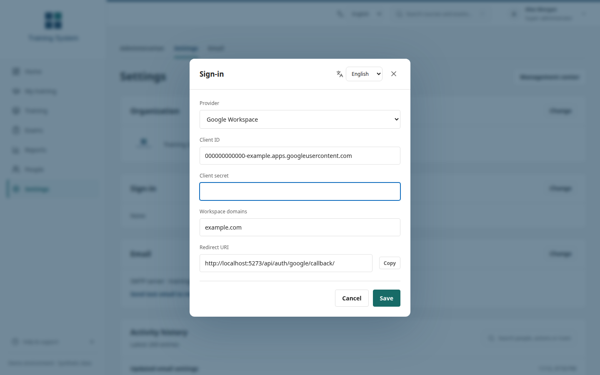

# Training System

供組織自行架設的訓練、課程編輯與評量系統。

**[試用示範](https://teddashh.github.io/Training-System/demo/)**：在瀏覽器中以合成資料操作實際介面，不會儲存任何變更。

[English](../README.md) · [Español](README.es.md)


## 可以做什麼

- 學習：修習課程、繼續 SCORM 教材，並追蹤必修訓練。
- 編輯：用 Studio 製作教材、匯入文件文字或上傳 SCORM 套件。
- 辦理梯次：安排訓練、辦理報名並記錄出席。
- 評量：建立考試、重複使用題庫並批改文字作答。
- 報表：查看完成情形、考試成績與試題分析，並匯出紀錄。
- 管理：管理人員、角色、組織設定、登入與電子郵件。

## 快速開始

安裝 Docker Engine 與 Compose v2。在儲存庫根目錄執行：

```bash
cp .env.example .env
chmod 600 .env
```

編輯 `.env`：將 `SECRET_KEY` 與 `POSTGRES_PASSWORD` 換成各自獨立的隨機值。本機試用保留 `DEBUG=true`，並設為 `DEMO_MODE=false`。服務提供者的憑證先留白。

```bash
docker compose up --build -d --wait
docker compose exec api python manage.py createsuperuser --username training-admin
docker compose exec api python manage.py shell -c "from training.models import User; u=User.objects.get(username='training-admin'); u.role='admin'; u.save(update_fields=['role'])"
```

依提示輸入管理員的電子郵件與密碼。最後一個指令會授予該帳號平台的「超級管理員」（Super administrator）角色。

開啟 <http://localhost:8080> 並登入。在側邊欄開啟「設定」，再點「設定」分頁（Settings → Settings），設定組織名稱與標誌、介面語言、登入方式及電子郵件。儲存後，若已啟用電子郵件，請按「寄送測試郵件給我」（Send test email to me）。

這是本機試用環境。請依[入門指南](GETTING-STARTED.md)完成第一個訓練流程，並參閱[部署指南](DEPLOYMENT.md)設定 HTTPS 與正式環境。

## 配合組織需求設定

在設定中輸入組織名稱並上傳標誌。介面可開放英文、繁體中文或西班牙文。編寫的教材保留原本語言。

登入可選 Microsoft Entra ID、Google Workspace，或使用密碼及電子郵件驗證碼的本機帳號。驗證碼需要可用的郵件服務。電子郵件可選 SMTP 伺服器、Microsoft 365 信箱或關閉。

由伺服器設定的欄位會顯示「由伺服器設定」（Set by the server）。可透過 `BRAND` 品牌套件在建置時變更色彩，請參閱[品牌指南](../DESIGN.md#brand-packs)。




## 畫面

[課程](screenshots/courses.png) · [Studio](screenshots/studio.png) · [梯次](screenshots/sessions.png) · [考試](screenshots/exam.png) · [分析](screenshots/insights.png) · [手機版](screenshots/mobile.png)

## 文件

| 指南 | 用途 |
| --- | --- |
| [入門](GETTING-STARTED.md) | 完成第一個訓練流程 |
| [部署](DEPLOYMENT.md) | 安裝、設定、備份與升級 |
| [操作](OPERATIONS.md) | 管理人員、課程、梯次、考試與報表 |
| [入門課程庫](course-library-sources.md) | 建置並匯入 60 門課程草稿 |
| [整合](INTEGRATIONS.md) / [API](SIMPLE-TRAINING-API.md) | 查看原始碼整合方式與 API 契約 |
| [安全](../SECURITY.md) / [設計](../DESIGN.md) | 查看信任邊界與品牌套件 |
| [上游稽核](UPSTREAM-AUDIT.md) | 查看已實作功能與待補項目 |

## 開發

使用 Python 3.13 與 Node.js 24：

```bash
python3.13 -m venv .venv
.venv/bin/pip install -r backend/requirements.txt
npm ci --prefix frontend
npm ci --prefix vendor/scormly
DEBUG=true .venv/bin/python backend/manage.py check
python3 scripts/check_upstream_audit.py
```

[本機開發指南](DEPLOYMENT.md#develop-locally)說明資料庫遷移與服務啟動。檢查包括 Django 測試、兩個前端建置、前端單元測試與 Studio 測試。並行檢查需要 PostgreSQL；瀏覽器流程需要獨立且已啟動的測試環境。

## 現況與限制

這是單一組織的工作區。尚未涵蓋所有上游功能，待完成項目記錄在稽核文件中。請在自己的部署環境驗證登入、寄信、還原與預期負載。

SCORM 支援單一 SCO 的 1.2/2004 執行功能子集，不支援多 SCO 定序，也未取得完整認證。LMS 不匯入 cmi5，也不提供 xAPI LRS。考試不支援監考、檔案上傳作答或隔離的程式執行環境。文件匯入只擷取文字，不包含 OCR 或投影片版面。

## 授權

新程式碼採用 [BSD 3-Clause](../LICENSE)。保留的上游原始碼維持原授權，詳見[第三方聲明](../THIRD_PARTY_NOTICES.md)。

[FOSSEE Yaksh](https://github.com/FOSSEE/online_test)提供保留的評量原始碼與遷移基礎。

[Scormly](https://github.com/dmmat/Scormly)提供整合的課程編輯器與匯出播放器。
